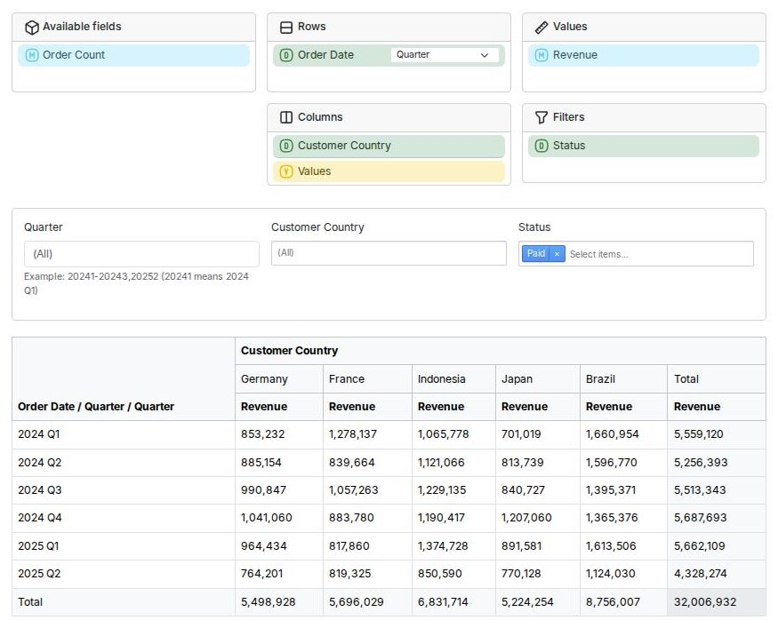

This guide takes an existing Doctrine entity, `Order`, and adds analytics to
it. At the end, you will have a page with a pivot table that your users can
rearrange by dragging and dropping fields:



## Requirements

* PostgreSQL. Other databases are not supported yet.
* A Symfony application using Doctrine ORM and Doctrine Migrations.
* Symfony Messenger with an asynchronous transport that supports delayed
  messages, like the Doctrine transport.
* AssetMapper and Stimulus, for the user interface.

A new application created using `symfony new --webapp` has all of these.

## The Starting Point

We start with these entities. An `Order` is placed by a `Customer`, who lives
in a `Country`. An order also has a status, and the order amount.

```php title="src/Entity/Order.php"
namespace App\Entity;

use Doctrine\DBAL\Types\Types;
use Doctrine\ORM\Mapping as ORM;

#[ORM\Entity()]
#[ORM\Table(name: 'orders')]
class Order
{
    #[ORM\Id]
    #[ORM\GeneratedValue]
    #[ORM\Column]
    private ?int $id = null;

    #[ORM\ManyToOne()]
    #[ORM\JoinColumn(nullable: false)]
    private Customer $customer;

    #[ORM\Column(enumType: OrderStatus::class)]
    private OrderStatus $status = OrderStatus::Pending;

    // the order amount, in cents
    #[ORM\Column]
    private int $amount;

    #[ORM\Column(type: Types::DATETIME_IMMUTABLE)]
    private \DateTimeImmutable $placedAt;

    // constructor, getters, and setters are omitted for brevity
}
```

```php title="src/Entity/OrderStatus.php"
namespace App\Entity;

enum OrderStatus: string
{
    case Pending = 'pending';
    case Paid = 'paid';
    case Shipped = 'shipped';
    case Cancelled = 'cancelled';
}
```

```php title="src/Entity/Customer.php"
namespace App\Entity;

use Doctrine\ORM\Mapping as ORM;

#[ORM\Entity()]
class Customer
{
    #[ORM\Id]
    #[ORM\GeneratedValue]
    #[ORM\Column]
    private ?int $id = null;

    #[ORM\Column]
    private string $name;

    #[ORM\ManyToOne()]
    #[ORM\JoinColumn(nullable: false)]
    private Country $country;

    // ...
}
```

```php title="src/Entity/Country.php"
namespace App\Entity;

use Doctrine\ORM\Mapping as ORM;

#[ORM\Entity()]
class Country implements \Stringable
{
    #[ORM\Id]
    #[ORM\GeneratedValue]
    #[ORM\Column]
    private ?int $id = null;

    #[ORM\Column]
    private string $name;

    // ...

    public function __toString(): string
    {
        return $this->name;
    }
}
```

`Country` implements `Stringable`, so the user interface knows how to display
it. Alternatively, an object can implement `TranslatableInterface`, or you can
create your own [formatter](./11-user-interface/11-formatter-services.md).

## Installation

Install the bundle, the frontend package, and the pivot table panel:

```bash
composer require rekalogika/analytics-bundle \
    rekalogika/analytics-frontend \
    rekalogika/analytics-ux-panel
```

Symfony Flex registers the bundles, adds the Stimulus controllers of the panel
to `assets/controllers.json`, and adds their JavaScript and CSS dependencies to
`importmap.php`.

## Configuring Messenger

When an order is created, changed, or deleted, the framework refreshes the
affected part of the summary table in the background, using Symfony
Messenger. Route the refresh message to an asynchronous transport:

```yaml title="config/packages/messenger.yaml"
framework:
    messenger:
        routing:
            # highlight-next-line
            Rekalogika\Analytics\Engine\RefreshAgent\RefreshAgentStartCommand: async
```

:::warning

The message must be routed to an asynchronous transport. If it is handled
synchronously, the refresh runs in the same process that flushes the orders,
and keeps triggering itself, making the flush very slow.

:::

## Creating the Summary Entity

A summary entity defines the summary table: which source entity it summarizes,
how the data is partitioned, and its dimensions and measures.

```php title="src/Entity/OrderSummary.php"
namespace App\Entity;

use Doctrine\Common\Collections\Order as SortOrder;
use Doctrine\DBAL\Types\Types;
use Doctrine\ORM\Mapping as ORM;
use Rekalogika\Analytics\Core\AggregateFunction\Count;
use Rekalogika\Analytics\Core\AggregateFunction\Sum;
use Rekalogika\Analytics\Core\Entity\BaseSummary;
use Rekalogika\Analytics\Core\Partition\DefaultIntegerPartition;
use Rekalogika\Analytics\Core\ValueResolver\IdentifierValue;
use Rekalogika\Analytics\Core\ValueResolver\IntegerValue;
use Rekalogika\Analytics\Core\ValueResolver\PropertyValue;
use Rekalogika\Analytics\Metadata\Attribute as Analytics;
use Rekalogika\Analytics\Time\Dimension\System\GregorianDate;
use Rekalogika\Analytics\Time\Metadata\TimeProperties;
use Symfony\Component\Translation\TranslatableMessage;

#[ORM\Entity()]
#[Analytics\Summary(
    sourceClass: Order::class,
    label: new TranslatableMessage('Orders'),
)]
class OrderSummary extends BaseSummary
{
    //
    // partition
    //

    #[ORM\Embedded()]
    #[Analytics\Partition(new IntegerValue('id'))]
    private DefaultIntegerPartition $partition;

    //
    // dimensions
    //

    #[ORM\Embedded()]
    #[Analytics\Dimension(
        source: new PropertyValue('placedAt'),
        label: new TranslatableMessage('Order Date'),
        orderBy: SortOrder::Ascending,
    )]
    #[TimeProperties(
        sourceTimeZone: new \DateTimeZone('UTC'),
        summaryTimeZone: new \DateTimeZone('Europe/Berlin'),
    )]
    private GregorianDate $placedAt;

    #[ORM\ManyToOne()]
    #[Analytics\Dimension(
        source: new IdentifierValue('customer.country'),
        label: new TranslatableMessage('Customer Country'),
    )]
    private ?Country $customerCountry = null;

    #[ORM\Column(enumType: OrderStatus::class, nullable: true)]
    #[Analytics\Dimension(
        source: new PropertyValue('status'),
        label: new TranslatableMessage('Status'),
    )]
    private ?OrderStatus $status = null;

    //
    // measures
    //

    #[ORM\Column(type: Types::BIGINT, nullable: true)]
    #[Analytics\Measure(
        function: new Sum('amount'),
        label: new TranslatableMessage('Revenue'),
    )]
    private ?int $revenue = null;

    #[ORM\Column(type: Types::INTEGER, nullable: true)]
    #[Analytics\Measure(
        function: new Count('id'),
        label: new TranslatableMessage('Order Count'),
    )]
    private ?int $count = null;

    //
    // getters
    //

    public function getPlacedAt(): GregorianDate
    {
        return $this->placedAt;
    }

    public function getCustomerCountry(): ?Country
    {
        return $this->customerCountry;
    }

    public function getStatus(): ?OrderStatus
    {
        return $this->status;
    }

    public function getRevenue(): ?int
    {
        return $this->revenue;
    }

    public function getCount(): ?int
    {
        return $this->count;
    }
}
```

* **Partition.** The summary table is divided into partitions by the ID of the
  orders. When an order changes, only its partition is recalculated.
  `DefaultIntegerPartition` is suitable for auto-incrementing integer IDs. See
  [partitioning](./02-summary-entity/02-partitioning.md).
* **Dimensions.** The properties you group and filter by. `placedAt` uses
  `GregorianDate`, a ready-made dimension group that breaks down the order time
  into year, quarter, month, date, and more. `customerCountry` follows the
  relation from `Order` to `Customer` to `Country`. See
  [dimensions](./02-summary-entity/03-dimensions.md) and
  [time dimensions](./08-time-dimension/01-dimension-groups.md).
* **Measures.** The aggregated values: the sum of the order amounts, and the
  number of orders. See [measures](./02-summary-entity/04-measures.md).
* **Getters.** The framework reads the values of the summary using getters, so
  every dimension and measure needs one.

To check how the framework understands your summary entity, run:

```bash
php bin/console rekalogika:analytics:debug:summary 'App\Entity\OrderSummary'
```

## Creating the Database Schema

Generate a migration for the summary table, and the tables that the framework
uses to track changes:

```bash
php bin/console doctrine:migrations:diff --namespace='App\Migrations'
php bin/console doctrine:migrations:migrate
```

:::note

The bundle comes with its own migrations, which create the SQL functions it
needs. Because of that, there is more than one migration namespace, and you
need to tell `doctrine:migrations:diff` to use your own. Use the namespace
specified in `config/packages/doctrine_migrations.yaml`, which might be
`DoctrineMigrations` in older applications.

:::

## Populating the Summary Table

The summary table is initially empty. Summarize the existing orders:

```bash
php bin/console rekalogika:analytics:refresh:range 'App\Entity\OrderSummary'
```

From now on, the summary table is updated automatically when orders are
created, changed, or deleted. Make sure a worker is consuming the messages:

```bash
php bin/console messenger:consume async
```

The updates are debounced, so changes appear in the summary within 30 minutes
by default. See [Refreshing](./03-housekeeping/02-refreshing.md) to adjust this.

## Creating the Pivot Table Page

The controller creates a query from the state of the panel, which the browser
passes in the URL as a JSON-encoded `parameters` query parameter. Then, it
renders the result as a pivot table.

```php title="src/Controller/OrderAnalyticsController.php"
namespace App\Controller;

use App\Entity\OrderSummary;
use Rekalogika\Analytics\Contracts\SummaryManager;
use Rekalogika\Analytics\Frontend\Html\TableRenderer;
use Rekalogika\Analytics\UX\PanelBundle\PivotAwareQueryFactory;
use Symfony\Bundle\FrameworkBundle\Controller\AbstractController;
use Symfony\Component\HttpFoundation\Response;
use Symfony\Component\HttpKernel\Attribute\MapQueryParameter;
use Symfony\Component\Routing\Attribute\Route;

final class OrderAnalyticsController extends AbstractController
{
    #[Route('/analytics/orders', name: 'analytics_orders')]
    public function index(
        SummaryManager $summaryManager,
        PivotAwareQueryFactory $pivotAwareQueryFactory,
        TableRenderer $tableRenderer,
        #[MapQueryParameter] ?string $parameters = null,
    ): Response {
        // the state of the pivot table panel, encoded in the URL as JSON
        $parameters = json_decode($parameters ?? '', true);

        if (!\is_array($parameters)) {
            $parameters = [];
        }

        $query = $pivotAwareQueryFactory->createFromParameters(
            query: $summaryManager->createQuery()->from(OrderSummary::class),
            parameters: $parameters,
        );

        $pivotTable = $tableRenderer->renderPivotTable(
            cube: $query->getResult(),
            rows: $query->getRows(),
            columns: $query->getColumns(),
            measures: $query->getValues(),
        );

        return $this->render('analytics/orders.html.twig', [
            'query' => $query,
            'pivotTable' => $pivotTable,
        ]);
    }
}
```

In the template, `analytics_render_control()` renders the panel. When the user
changes the panel, it fetches the page again with the new parameters, and puts
the new pivot table in the element specified by `target`.

```twig title="templates/analytics/orders.html.twig"


Orders


    {{ parent() }}
    <link rel="stylesheet" href="https://cdn.jsdelivr.net/npm/bootstrap@5.3.8/dist/css/bootstrap.min.css">



    <div class="container my-5">
        {{ analytics_render_control(
            query: query,
            output: pivotTable,
            target: 'pivot-table',
            urlParameter: 'parameters',
        ) }}

        <div id="pivot-table" class="mt-4"></div>
    </div>

```

The panel is styled using Bootstrap 5. Remove the stylesheet above if your
application already uses Bootstrap. To render the pivot table using Bootstrap
too, change the table theme:

```yaml title="config/packages/rekalogika_analytics.yaml"
rekalogika_analytics:
    table_theme: "@RekalogikaAnalyticsFrontend/bootstrap_5_renderer.html.twig"
```

## Trying It Out

Open `/analytics/orders` in your browser. Initially, the pivot table is empty.
To populate it:

1. Drag *Order Date* to *Rows*, and choose the level of detail, for example
   *Quarter*.
2. Drag *Customer Country* to *Columns*.
3. Drag *Revenue* to *Values*.
4. Drag *Status* to *Filters*, and select the statuses to include.

Every dimension in *Rows*, *Columns*, or *Filters* also gets a filter control
below the panel. The state of the panel is kept in the URL, so you can
bookmark or share it.

## Next Steps

* [Querying](./04-query/01-querying.md) the summary from your own code.
* Rendering the result as a [chart](./11-user-interface/02-chart-generator.md)
  or a [spreadsheet](./11-user-interface/03-spreadsheet-renderer.md).
* [Formatting](./11-user-interface/11-formatter-services.md) the values, for
  example to display the revenue as money instead of cents.
* Choosing which [grouping sets](./07-dimension-hierarchy/02-grouping-strategy.md)
  are stored, when the summary has many dimensions.
